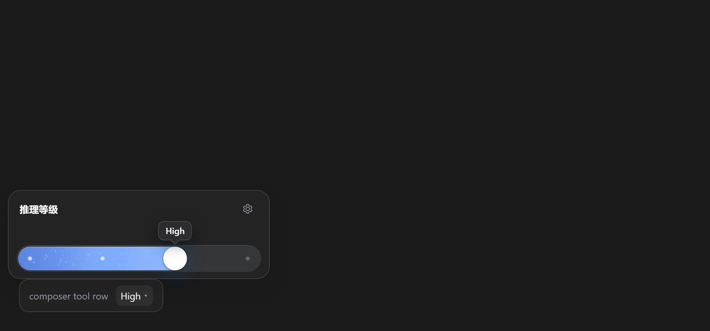
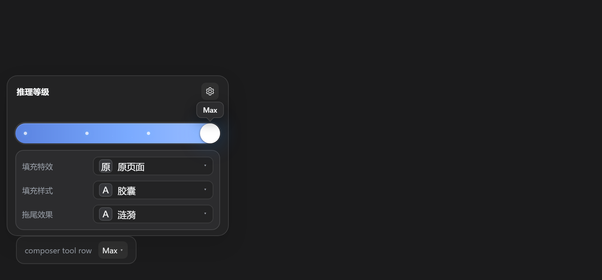
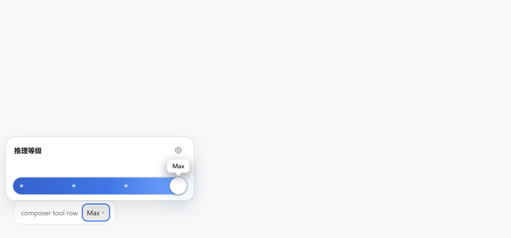
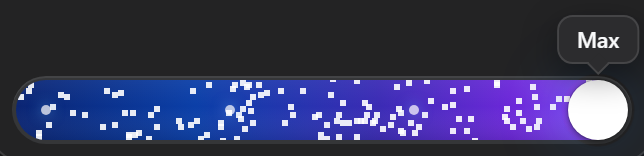

# dsh-composer-effort-slider

[](LICENSE)
[](https://www.npmjs.com/package/dsh-composer-effort-slider)
[](https://github.com/deepseek-ai)

把 DeepSeek Harness 的**推理等级**做成输入框里的一个滑杆：点开即拖，松手写回当前会话。

A reasoning-effort slider for the DeepSeek Harness composer — click the level in the
tool row, drag the capsule, and the change applies to the next request.




| Light theme | Warp fill effect |
| --- | --- |
|  |  |

English | [中文](#中文说明) · [更新记录](CHANGELOG.md) · [参与开发](CONTRIBUTING.md)

---

## 为什么做它

官方把「推理等级」放在模型菜单的二级页里：点模型 → 点 Effort → 选档，三步。这个插件把它下沉成**一步**，同时保留官方语义：

- 档位来自模型的 `reasoning.efforts` 元数据，不写死；
- 读写走同一个 `modelDirectories`，和自带模型菜单、`/model` 命令永远一致；
- 选择是「下一个请求生效」，运行中的步骤不会被中途改档。

它没有新增任何模型能力，只是把已有能力放到手边。

## 功能

| | |
| --- | --- |
| **一步切档** | 工具行显示 `Off / Low / High / Max`，点开是胶囊滑杆 + 档位气泡 + 轨道粒子 |
| **跟随模型** | 档位列表来自 `reasoning.efforts`；模型没有 reasoning 元数据时整个控件隐藏 |
| **共享写路径** | `modelDirectories.select({ provider, model, reasoningEffort })`，与官方菜单同源 |
| **外观设置** | 填充特效（原页面 / 音频条 / 极光 / 格子 / 超空间）、填充样式（胶囊 / 通栏）、拖尾（6 种），`localStorage` 持久化 |
| **跟随主题** | 亮/暗两套宿主配色，弹层与组件通过 CSS 变量接线 |
| **可访问** | dialog + slider 语义、方向键 / Home / End、`Esc` 逐层关闭、`prefers-reduced-motion` |
| **零 Host 逻辑** | Host 半边是空 `apply()`，全部逻辑在浏览器端 |

## 安装

从 npm：

```bash
dsh plugin --profile desktop add dsh-composer-effort-slider
```

本地检出（开发）：

```bash
dsh plugin --profile desktop add link:/absolute/path/to/dsh-composer-effort-slider
```

安装后重启应用（或刷新页面）。

## 使用

1. 在会话里点输入框工具行的档位标签（如 `High ▾`）；
2. 拖动滑块或用方向键，松手后写回（120ms 合并，一次拖动只写一次）；
3. 右上角齿轮打开外观设置；拖尾只有在「原页面」特效下可选。

改动对**下一个请求**生效；正在跑的步骤保持它开始时的档位。

## 兼容性

- 实测 DeepSeek Harness `0.2.1-rc.2`（desktop profile）。
- 依赖已发布包的客户端契约：`modelDirectories`、`sessions`、`slots`、`locale`。这些不是公开插件 API，Harness 升级可能需要跟进。
- 组件按 DeepSeek 的四档设计；模型档位数量不是 4 时隐藏控件，而不是渲染错位的滑杆。

## 已知限制

- 只支持四档（组件约束，见路线图）。
- 超空间特效速度为固定值，不暴露给用户。
- 极光特效需要 WebGL；不可用时轨道为空（组件自身降级行为）。
- 外观设置存在浏览器 `localStorage`，不跨设备同步。

## 架构

```
src/wrapper.js            React 外壳：触发器、弹层、设置、目录读写
src/reasoning-effort.js   <reasoning-effort> 组件，原样嵌入
client.js                 构建产物：外壳 + 组件合成一个 client module
index.js                  空的 Host 半边
cordis.patch.yml          bundle 注册
locale/{en,zh}.json       插件显示元数据
icon.svg                  图标
docs/                     README 截图
dev/                      构建脚本 + 本地 Playwright 回归
```

**为什么组件要内嵌**：DSH 的 client 插件是单文件 bundle（`window.__ModuleLoader__.load`），不能 `import` 同包的另一个文件。所以 `dev/build.mjs` 把组件源码原样拼进 `client.js`，组件本身不做任何改写——它的几何是运行时量出来的，和 demo 页行为一致。

```bash
node dev/build.mjs        # src/*.js -> client.js
```

`dev/harness.html` + `dev/drive.py` 用假模型目录驱动 `client.js`，断言：档位读写、4 档点、外观设置、拖尾禁用、`Esc` 分层、3 档/无 reasoning 隐藏。依赖 Python Playwright 与 `dev/node_modules/react`：

```bash
npm install --prefix dev react@18.2.0 react-dom@18.2.0
python dev/drive.py
```

## 路线图

按优先级排列，欢迎认领：

- [ ] **动态档位数** —— 把组件里写死的 `LEVELS` 改成运行时注入，支持 2–6 档的模型
- [ ] **超空间参数化** —— 速度/密度从常量变成设置项（或随档位自动调整）
- [ ] **极光降级** —— WebGL 不可用时自动回退到「原页面」，而不是空轨道
- [ ] **设置同步** —— 外观选择跟随 profile 配置，而不是单个浏览器
- [ ] **快捷键** —— 例如 `Alt+←/→` 直接切档，不打开弹层
- [ ] **CI** —— 把 `dev/drive.py` 的断言搬进 GitHub Actions（headless Chromium）
- [ ] **上游自检** —— 脚本检查 `modelDirectories` 的 store 形状是否漂移
- [ ] **发布** —— npm 与 DSH 插件市场收录

## 参与开发

见 [CONTRIBUTING.md](CONTRIBUTING.md)。改动请同时更新 `CHANGELOG.md`，并跑一遍 `node dev/build.mjs && python dev/drive.py`。

## License

MIT © 2026 Hub-spec · 见 [LICENSE](LICENSE)

---

## 中文说明

把推理等级做成输入框里的一个滑杆：点开即拖，松手写回当前会话。官方原本藏在「模型 → 推理等级」二级页里，这个插件把它变成一步。

**特性**

- 档位来自模型元数据（`reasoning.efforts`），不是写死的；模型不支持推理等级时隐藏。
- 读写走官方 `modelDirectories`，和自带模型菜单、`/model` 保持同步。
- 齿轮里有填充特效 / 填充样式 / 拖尾效果，选择会记住；拖尾只在「原页面」特效下可选。
- 亮/暗主题都跟随宿主；键盘（←→/Home/End）与 `prefers-reduced-motion` 都有处理。
- 改动对**下一个请求**生效。

**安装**

```bash
dsh plugin --profile desktop add dsh-composer-effort-slider    # npm 发布后
dsh plugin --profile desktop add link:<本仓库根目录>            # 本地开发
```

**开发**

源码在 `src/`，改完执行 `node dev/build.mjs` 重新生成 `client.js`；`dev/drive.py` 是本地回归。

**已知限制**：只支持四档；超空间速度为固定值；极光需要 WebGL。

**路线图**：动态档位数、超空间参数化、极光降级、设置同步、快捷键、CI、上游自检、正式发布。

MIT 协议，见 [LICENSE](LICENSE)。
